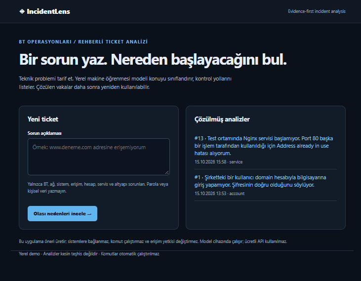
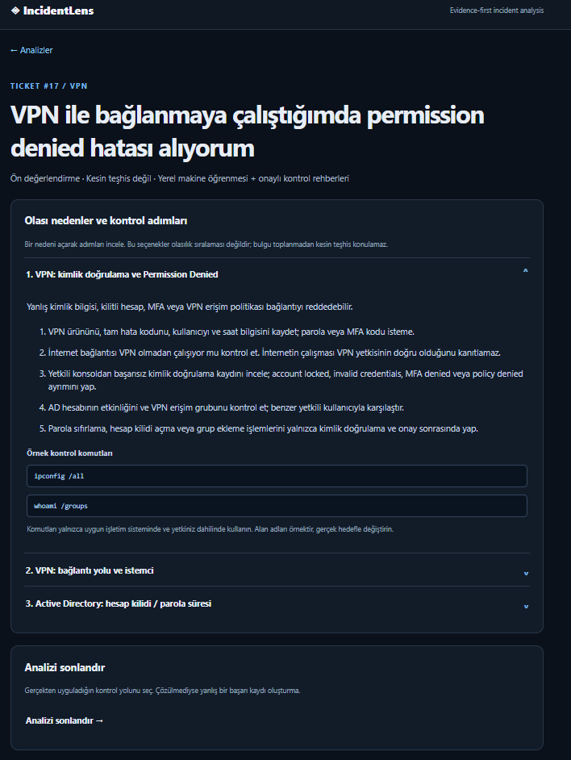
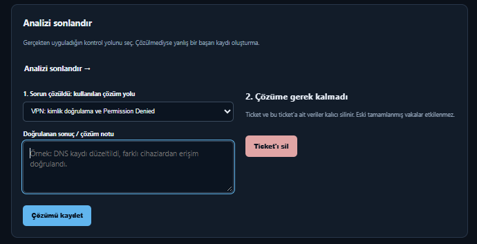

# IncidentLens

### Yerel Makine Öğrenmesi Destekli BT Olay Analizi ve Ticket Yönetimi

**IncidentLens**, BT destek ve sistem/altyapı operasyonlarında karşılaşılan teknik sorunları sınıflandırmak, ilgili kontrol adımlarını sunmak ve çözülen vakalardan yeniden yararlanmak amacıyla geliştirilmiş yerel bir web uygulamasıdır.

Uygulama, **scikit-learn tabanlı yerel metin sınıflandırması**, gözden geçirilmiş teknik rehberler ve **PostgreSQL destekli ticket geçmişini** bir araya getirir. Ücretli bir yapay zekâ API'si gerektirmez.

> **Proje türü:** Portföy / yerel prototip. Uygulama kesin arıza teşhisi koymaz; sistemlere bağlanmaz, komut çalıştırmaz ve erişim yetkilerini değiştirmez.



## Özellikler

- **Teknik talep sınıflandırması:** Girilen BT sorununu yerel makine öğrenmesi modeliyle ilgili kategoriye yönlendirir.
- **Rehberli inceleme:** VPN, DNS, Active Directory/hesap, yetkilendirme, servis ve benzeri konularda olası nedenler ile kontrol adımlarını sunar.
- **Ticket yaşam döngüsü:** Talep oluşturma, inceleme, kullanılan çözüm yolunu seçme, çözüm notu kaydetme veya gereksiz talebi silme.
- **Geçmiş vaka eşleştirmesi:** Çözülen benzer ticket'ları arar ve uygun geçmiş çözüm yolunu öne çıkarır.
- **Log analiz örnekleri:** Nginx servis/port/yapılandırma ve DNS hata kayıtları için örnek analiz senaryoları.
- **Temel güvenlik sınırları:** BT dışı istekleri ve bazı talimat manipülasyonu örneklerini reddetmeye yönelik kontroller; kullanıcı girdisi komut olarak çalıştırılmaz.

## Uygulama ekranları

### 1. Teknik sorunun incelenmesi

Kullanıcı, karşılaştığı problemi doğal dille tanımlar. IncidentLens ilgili teknik kategori için olası nedenleri, inceleme sırasını ve örnek kontrol komutlarını gösterir.



### 2. Çözümün kayıt altına alınması

Sorun giderildikten sonra kullanılan çözüm yolu ve doğrulama notu ticket'a kaydedilebilir. Bu kayıt, benzer bir talep oluştuğunda yeniden kullanılabilir.



## Kullanılan teknolojiler

| Katman | Teknoloji | Görevi |
| --- | --- | --- |
| Backend | Python, FastAPI | Web istekleri ve iş akışı |
| Arayüz | Jinja2, HTML, CSS | Sunucu tarafında oluşturulan web ekranları |
| Veritabanı | PostgreSQL, SQLAlchemy | Ticket ve çözüm geçmişinin kalıcı saklanması |
| Makine öğrenmesi | scikit-learn, TF-IDF, Logistic Regression | Yerel teknik metin sınıflandırması |
| Konteyner | Docker, Docker Compose | Uygulama ve PostgreSQL servislerinin çalıştırılması |
| Test | pytest | Otomatik davranış ve akış testleri |

## Mimari

```text
Kullanıcı / Web Tarayıcısı
          |
          v
    FastAPI + Jinja2
          |
          +--> Yerel ML sınıflandırıcı
          |       (TF-IDF + Logistic Regression)
          |
          +--> Teknik bilgi tabanı
          |       (kontrol rehberleri)
          |
          +--> Ticket servisi
                  |
                  +--> Benzer çözülmüş vaka araması
                  |
                  v
              PostgreSQL
```

Sınıflandırıcı teknik kategori önerir. Teknik çözüm metinleri üretken bir dil modeli tarafından yazılmaz; uygulamanın bilgi tabanındaki rehberlerden gelir. Benzer geçmiş vakalar uygulama mantığıyla eşleştirilir.

## Yerel kurulum

**Gereksinimler:** Docker Desktop ve Docker Compose.

```powershell
# Projeyi indirdikten sonra proje dizininde:
Copy-Item .env.example .env
```

`.env` içindeki örnek PostgreSQL parolasını ve buna karşılık gelen `DATABASE_URL` bilgisini yerel kullanım için güncelleyin.

```powershell
docker compose up --build -d
```

Tarayıcıda **http://localhost:8000** adresini açın.

Servisleri durdurmak için:

```powershell
docker compose down
```

> `docker compose down -v` komutu veritabanı volume'unu da silebilir. Kayıtlı ticket'ları korumak için kullanmayın.

## Örnek kullanım senaryosu

1. Kullanıcı "VPN ile bağlanırken permission denied hatası alıyorum" şeklinde ticket oluşturur.
2. Uygulama sorunu sınıflandırır ve kimlik doğrulama, hesap kilidi, MFA ve erişim politikalarıyla ilgili kontrol rehberlerini gösterir.
3. Kullanıcı, gerçekten uyguladığı kontrol yolunu ve doğrulanan sonucu kaydeder.
4. Benzer bir ticket geldiğinde önceki çözülmüş kayıt, eşleşme koşulları sağlanıyorsa yeniden önerilir.

## Testler

Docker içindeki Python 3.12 ortamında çalıştırılan otomatik testlerin son doğrulama sonucu:

```text
9 passed in 1.62s
```

Testler arasında örnek log analizi, konu dışı istek kontrolü, temel prompt injection reddi, ticket oluşturma, çözüm kaydetme, geçmiş vaka eşleştirmesi ve ticket silme senaryoları bulunur.

Geliştirme ortamında bağımlılıklar kuruluysa testler şu şekilde çalıştırılabilir:

```powershell
python -m pip install -r requirements-dev.txt
python -m pytest tests -v
```

> Testlerin geçmesi tüm olası sorunların doğru sınıflandırıldığını veya uygulamanın üretim ortamı için güvenlik denetiminden geçtiğini kanıtlamaz.

## Güvenlik ve sınırlamalar

- Yerel kullanım için tasarlanmıştır; kimlik doğrulama ve kurumsal yetkilendirme katmanı bulunmadığından internete açık üretim servisi olarak kullanılmamalıdır.
- Komut örnekleri bilgilendirme amaçlıdır; otomatik çalıştırılmaz.
- Teknik sınıflandırma ve geçmiş vaka eşleştirmesi hatalı sonuçlar verebilir. Son teşhis insan tarafından doğrulanmalıdır.
- Kullanıcılar gerçek parolaları, erişim anahtarlarını veya gizli kurum verilerini ticket alanlarına girmemelidir.
- Bu sürümde üretken LLM ile dinamik teşhis bulunmaz. Yapay zekâ bileşeni yerel makine öğrenmesi sınıflandırıcısıdır.

## Geliştirme hedefleri

- Teknik log ve komut çıktılarına göre aşamalı teşhis akışları
- Daha kapsamlı ve etiket kalitesi doğrulanmış eğitim verisi
- Model başarımının ayrı doğrulama verisiyle ölçülmesi
- Kimlik doğrulama, rol tabanlı erişim ve denetim kayıtları

---

**IncidentLens**, BT operasyonlarında olay analizi, dokümantasyon, tekrar eden sorunların yönetimi ve güvenli otomasyon yaklaşımını uygulamalı olarak göstermek için geliştirilmiştir.
